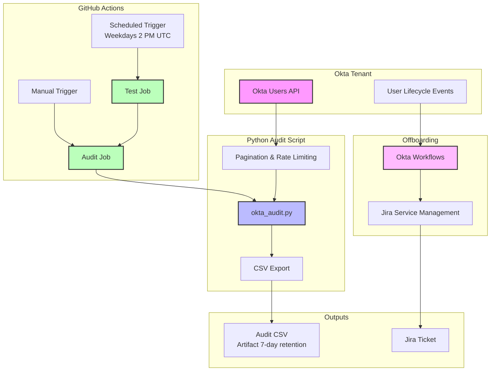

# Okta IT Automation

A collection of tools and workflows for automating Okta identity management tasks, including user auditing and offboarding automation.

## Problem Statement

Managing Okta identity at scale requires continuous monitoring of security posture and streamlined offboarding processes. Manual audits are time-consuming and error-prone, while offboarding tasks often fall through the cracks during high-pressure departures. This project addresses both challenges with automated, read-only auditing and event-driven offboarding workflows.

## Architecture



## Components

### 1. User Audit Script (`okta_audit.py`)

A read-only Python script that:
- Exports all Okta users with status, last login, group membership, and MFA factors to CSV
- Flags ACTIVE accounts that haven't logged in within a configurable threshold (default: 30 days)
- Identifies users without MFA enrolled
- Uses Okta's API with rate limiting (HTTP 429 with Retry-After), pagination, and retry logic
- Returns nonzero exit codes on failures for CI integration

**Key Features:**
- Structured logging with timestamps
- Okta URL format validation
- Configurable stale threshold and output path
- Stable CSV column ordering
- Error counting and reporting
- Never makes state-changing API calls

### 2. Okta-to-Jira Offboarding Workflow

An Okta Workflows automation that:
- Triggers when a user is deactivated in Okta
- Retrieves user details via Okta API
- Creates a corresponding Jira Service Management ticket
- Maps user identity to Jira request fields

**Implementation:** Okta Workflows (no-code automation platform, flopack format)
**Documentation:** See [flows/OFFBOARDING_WORKFLOW.md](flows/OFFBOARDING_WORKFLOW.md)

### 3. GitHub Actions Integration

Automated CI/CD pipeline that:
- Runs tests on every workflow execution
- Executes audit on weekdays at 2 PM UTC
- Supports manual triggering via Actions UI
- Uploads audit results as artifacts with 7-day retention
- Uses minimal permissions (contents: read)
- Pins third-party actions to commit SHAs

## Prerequisites

- Python 3.11+
- Okta organization with API access
- Okta API token with read permissions
- (Optional) Jira Service Management for offboarding workflow

## Setup

### 1. Clone the Repository

```bash
git clone https://github.com/nweekes423/okta-it-automation.git
cd okta-it-automation
```

### 2. Install Dependencies

```bash
pip install -r requirements.txt
```

### 3. Configure Environment Variables

Copy the example environment file:

```bash
cp .env.example .env
```

Edit `.env` with your actual values:

```bash
OKTA_ORG_URL=https://your-org.okta.com
OKTA_API_TOKEN=your_api_token_here
```

**Do not commit `.env` to version control.**

### 4. Run the Audit Locally

```bash
python okta_audit.py --stale-days 30 --output okta_audit.csv
```

Expected output:

```
2024-10-12 14:00:00 - INFO - Starting audit with 30-day stale threshold
2024-10-12 14:00:05 - INFO - Retrieved 150 users
2024-10-12 14:00:20 - INFO - Wrote 150 rows to okta_audit.csv
2024-10-12 14:00:20 - INFO - Users: 150  Active: 120
2024-10-12 14:00:20 - INFO - Stale (>30 days or never logged in): 5
2024-10-12 14:00:20 - INFO - Active without MFA: 2
2024-10-12 14:00:20 - INFO - Audit complete: okta_audit.csv
```

### 5. GitHub Actions Setup

1. Go to your repository Settings > Secrets and variables > Actions
2. Add two new repository secrets:
   - `OKTA_ORG_URL` - Your Okta org URL
   - `OKTA_API_TOKEN` - Your Okta API token
3. The workflow will run automatically on weekdays at 2 PM UTC
4. Trigger manually from Actions tab > Okta User Audit > Run workflow

## Sample CSV Output

```csv
id,login,name,email,status,created,last_login,days_since_login,groups,mfa_factors,has_mfa,stale
00u123abc,john.doe@example.com,John Doe,john.doe@example.com,ACTIVE,2024-01-15T10:00:00.000Z,2024-10-10T08:30:00.000Z,2,Everyone; IT; Engineering,token:software:totp:OKTA,true,false
00u456def,jane.smith@example.com,Jane Smith,jane.smith@example.com,ACTIVE,2024-02-01T09:00:00.000Z,2024-08-15T14:20:00.000Z,58,Everyone; HR,,true,true
00u789ghi,bob.wilson@example.com,Bob Wilson,bob.wilson@example.com,STAGED,2024-10-01T11:00:00.000Z,,,Everyone,,false,false
```

*Note: This is synthetic data for demonstration purposes.*

## Testing

Run the test suite locally:

```bash
pytest test_okta_audit.py -v
```

Tests cover:
- Successful user retrieval and pagination
- Stale-account detection and boundary dates
- Missing MFA and incomplete user profiles
- API errors, timeouts, rate limits, and retry exhaustion
- CSV output and escaping
- Missing environment variables and invalid configuration
- Read-only safety (no state-changing API calls)

## CI/CD

The GitHub Actions workflow:

1. **Test Job** (5 min timeout):
   - Checks out code
   - Sets up Python 3.11
   - Installs dependencies from requirements.txt
   - Runs pytest with verbose output

2. **Audit Job** (10 min timeout, depends on test):
   - Runs the audit script
   - Uploads CSV as artifact only on success
   - 7-day artifact retention

## Security Controls

### Implemented
- All API tokens read from environment variables, never hardcoded
- `.env` excluded from Git via .gitignore
- CSV output files excluded from Git via .gitignore
- Okta URL format validation before API calls
- Audit script is read-only (only GET requests)
- GitHub Actions uses minimal permissions (contents: read)
- Third-party actions pinned to commit SHAs
- Structured logging (no token exposure)
- Tests verify read-only behavior

### Required Okta API Token Permissions
- Read Users
- View Groups
- Read Factors (optional, some tenants restrict this)

### Limitations
- Audit script requires Okta API token with read permissions
- Offboarding workflow requires Okta Workflows subscription
- GitHub Actions artifacts are accessible to repo collaborators
- No encryption at rest for CSV artifacts
- No built-in alerting for policy violations

## Troubleshooting

### "OKTA_API_TOKEN environment variable not set"
- Ensure `.env` file exists with required variables
- For GitHub Actions, verify secrets are configured in repo settings

### "Invalid OKTA_ORG_URL format"
- URL must match pattern: `https://<org>.okta.com`
- Do not include `-admin` suffix or trailing paths
- Do not include trailing slash

### "Rate limited too many times"
- Script automatically retries with exponential backoff
- Check Okta API rate limits in Admin Console
- Consider increasing `MAX_RETRIES` constant if needed

### "Failed to fetch factors for user"
- Some Okta tenants restrict MFA factor endpoint access
- This is expected; script continues without factor data
- Check logs with `--verbose` flag for details

### GitHub Actions test failures
- Run tests locally: `pytest test_okta_audit.py -v`
- Check Python version compatibility (requires 3.11+)
- Verify all dependencies installed: `pip install -r requirements.txt`

### Offboarding workflow not triggering
- Verify User Lifecycle Events enabled in Okta Admin Console
- Check Okta Workflows connection status
- Review workflow activation in Okta Workflows UI
- See [flows/OFFBOARDING_WORKFLOW.md](flows/OFFBOARDING_WORKFLOW.md) for details

## Audit vs. Offboarding

**Audit Script (`okta_audit.py`):**
- **Purpose:** Continuous security posture monitoring
- **Trigger:** Scheduled (GitHub Actions) or manual CLI
- **Output:** CSV file with user security data
- **Action:** Read-only, no state changes
- **Frequency:** Daily automated, on-demand manual

**Offboarding Workflow:**
- **Purpose:** Automated ticket creation on user deactivation
- **Trigger:** Okta User Lifecycle Event (deactivation)
- **Output:** Jira Service Management ticket
- **Action:** Creates Jira ticket (read from Okta, write to Jira)
- **Frequency:** Event-driven, per user deactivation

## Engineering Decisions

### Pagination Strategy
Okta API uses Link headers for pagination. The script follows `next` links until exhausted, ensuring all users are retrieved regardless of tenant size. This approach handles large tenants (10,000+ users) without memory issues.

### Rate Limiting
Okta returns HTTP 429 with either `Retry-After` (seconds) or `X-Rate-Limit-Reset` (Unix timestamp). The script respects both headers with exponential backoff for transient errors, preventing API abuse while maximizing throughput.

### Least Privilege
The audit script uses only GET requests and requires only read permissions on Okta API. No write operations (POST, PUT, DELETE) are performed, ensuring it cannot accidentally modify user state, deactivate accounts, or change security policies.

### Testing Without Live Credentials
All tests use mocked HTTP responses via `pytest-mock`. This allows CI to run without access to real Okta or Jira tenants, enables edge case testing (rate limits, malformed responses), and prevents credential exposure in test logs.

### Failure Handling
The script distinguishes between recoverable errors (rate limits, timeouts) and fatal errors (authentication failures, invalid URLs). Recoverable errors trigger retries with backoff; fatal errors exit with nonzero status code to fail CI. Individual user processing errors are logged but don't abort the entire audit.

### GitHub Actions Design
Separate test and audit jobs ensure code quality before running production audits. Test job runs quickly (5 min timeout) to catch regressions. Audit job depends on test passing, preventing bad code from running against production Okta tenant. Artifacts only uploaded on success to avoid exposing partial/failed results.

## License

See LICENSE file for details.
